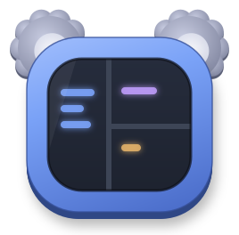
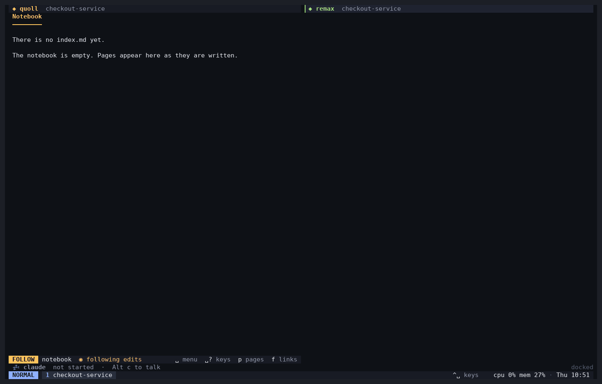

<p align="center"></p>

<h1 align="center">komux</h1>

A terminal multiplexer that agents can drive. Phase 1 is the agent forms layer: an agent asks the user questions, a form pops up in their terminal, and the answers come back as JSON. The form opens as a popup when the agent runs inside komux, or in a zellij floating pane or a tmux popup.



*A tab in the `ide` layout: quoll on the left, remax on the right, and native Claude docked below. Alt+c sends Claude a bug to fix. quoll follows the plan as Claude writes it, Claude asks how to round through a komux popup, and remax follows the edit when it lands. Then the dock shows Claude's reply, Alt+p opens it, and Alt+j opens the conversation. Waiting on the model is time-lapsed.*

## Setup

```bash
bun install
bun link                          # puts `komux` on PATH
claude mcp add komux -- komux mcp # gives Claude Code the ask and wait tools
komux setup --yes                 # adds komux's hooks, skill and rules to Claude Code's config
```

`komux setup` lists what komux adds to Claude Code's config and whether each part is there: the hooks below, the `komux-ask` and `komux-script` skills so agents know when and how to ask and run scripts, and two rules. `komux-jobs` has Claude run long commands as komux jobs with short names, and `komux-replies` lets it quiet replies that need nothing from you. `--yes` sets up whatever is missing, `--pick` lets you choose in a form, and `--remove` takes it all out again. The skill and rules are links into this checkout, so they follow it as you update it. Anything else already there under the same name is moved to `~/.claude/komux-backup/` and put back by `--remove`; `komux claude`'s offer only adds what is missing, and leaves moving things aside to `komux setup`. `komux claude` offers the same when it starts inside komux.

The `ask`, `wait` and `script_*` tools are marked read-only, so Claude Code can use them in plan mode without asking permission. Scripts can only change what komux shows, so they count as read-only too.

### macOS support

komux runs on macOS, but it needs `setsid`, which is available in the util-linux package. Homebrew installs util-linux keg-only (off your PATH), so link just `setsid` to minimize impact to your runtime:

```bash
brew install util-linux
mkdir -p ~/.local/bin   # or any directory on your PATH
ln -s "$(brew --prefix util-linux)/bin/setsid" ~/.local/bin/setsid
```

## Usage

```bash
komux form examples/deploy.json                   # try a form in this terminal
komux ask examples/deploy.json --wait             # pop it up for the user and wait
komux ask spec.json                               # pop it up and return an id
komux wait <id> --timeout 50                      # collect the answer later
komux open <id>                                   # show a pending ask's form, e.g. one asked with no host
komux pending                                     # list unanswered asks
komux schema                                      # JSON Schema for form specs
komux mcp                                         # MCP server on stdio
```

Run `komux --help` for every option. `skills/komux-ask/SKILL.md` documents the form spec.

### Keys in a form

| Key | Action |
|-----|--------|
| Tab / Shift+Tab | next / previous field |
| ↑ ↓ | move through choice options; move between other fields; leave a multi-line box from its first or last line |
| ← → | Yes/No on a confirm (also `y`/`n`), adjust a number |
| Space | toggle a multi-choice option |
| Enter | next field (a new line in a multi-line box); submit when on the submit button |
| Ctrl+S | submit from anywhere |
| Esc / Ctrl+C | cancel |

The bottom bar lists the keys that work in the focused field.

## How asks work

Each ask is stored as a directory under `$XDG_RUNTIME_DIR/komux/asks/<id>/`. Set `KOMUX_STATE_DIR` to store them somewhere else.

- **Files:** `spec.json` holds the form, and `result.json` appears once the user submits or cancels. The first result written wins.
- **Lifecycle:** closing the form's pane records a cancel. Asks older than a day are deleted.
- **No daemon:** `ask`, `wait`, the MCP server, and the form process share state only through these files.

## Layout jobs

A layout in `~/.config/komux/config.ts` can list `jobs`: commands that start out of sight with the tab, like jobs from Ctrl+s n, and close with it. `dock: true` docks one from the start. `projects.layoutFor` picks a layout for a particular project, overriding `projects.layout`:

```ts
export default {
  projects: { layout: "ide", layoutFor: { "dashboard": "dashboard" } },
  layouts: {
    "dashboard": {
      jobs: [{ command: ["dashboard", "serve"], name: "server", dock: true }],
      row: [{ command: ["dashboard", "pane", "stories"], focus: true }, { column: [{ command: ["dashboard", "pane", "reviews"] }, { command: ["dashboard", "pane", "mentions"] }] }],
    },
  },
};
```

- **Named tabs:** `tabs: { "dashboard": { layout: "dashboard", cwd: "~/work/initech/dashboard" } }` defines a tab with its own layout and working directory. Named tabs appear first in the Ctrl+t o launcher and work with `komux project`, so a closed one can be reopened, which also restarts its jobs.
- **Args:** a layout with `args: ["pr"]` is opened by `komux project --layout pr-review --arg pr=12`, which fills `{pr}` into its commands, job names, drawer, and tab `name`, along with `{project}`. `name: "{project} #{pr}"` gives each PR its own tab, so the same args switch back to it. Such a layout can't be a project's or named tab's default.
- **Repos:** `komux project --repo initech/dashboard` opens the clone under `projects.roots` whose path ends in `initech/dashboard`.
- **Startup:** `startup: ["dashboard"]` opens those named tabs when a session starts, instead of a plain tab.
- **Shared directory:** every pane and job in a tab gets `KOMUX_TAB_DIR`, a private directory for that tab. A job can put its socket there for the tab's panes to find.
- **Without jobs:** Alt+Enter in the Ctrl+t o launcher opens a project without starting its layout's jobs. Ctrl+s s starts them later.
- **Earlier configs:** layouts used to take `services`; rename them to `jobs`.

From inside a pane, `komux pane open [--right|--below|--tab] [--name NAME] [--no-focus] -- COMMAND...` opens a pane beside it in the same tab and prints the new pane's id. With `--popup` (and optionally `--width`/`--height` in percent), the command opens over the tab at once and takes the keys. The popup closes when the command exits successfully. After a failure it stays up until the next key, so the error can be read.

## The drawer

**Alt d** slides a shell up over the bottom of the tab, full width, above the mode row. Each tab has its own drawer, started in the focused pane's directory the first time it opens. Hiding it leaves the shell running, so Alt d brings it back with its scrollback.

- **Open means focused:** the drawer hides when focus leaves it, by Alt d, Alt t, Alt o/e, or a click on a pane above, and focus goes back to the pane you came from. Other focus keys do nothing while it is open. Pane mode works on it: **f** fills the screen with it, **x** closes it, **c** renames it.
- **Height:** pane mode **e** enters resize mode, where ↑/k/t make it taller and ↓/j/n shorter, from 20% to 80% of the screen.
- **Popups:** questions, jobs, and peeks open over the drawer and take the keys until they close, and the drawer is still open when they do.
- **Exits:** a shell that exits closes the drawer, and the next Alt d starts a new one.

A layout can put something other than a shell in its tabs' drawers. Like any layout pane, a command that exits is held until Enter re-runs it, Esc swaps in a shell, or Ctrl+c closes it:

```ts
layouts: {
  ide: { drawer: { command: ["lazygit"], name: "git", height: 50 }, row: [{}, {}] },
},
```

## Jobs

A job is a command that runs out of sight in a tab, in a terminal of its own. Press Ctrl+s for jobs mode, which lists the tab's jobs:

- **n** prompts for a command and runs it as a job in the focused pane's directory.
- **b** sends the focused pane to the background while it is busy with a long command. Its shell keeps running, and the job is done when that command finishes. This needs the fish integration that also drives the `⏳` badges.
- **↑/↓** pick a job, **Enter** opens it over the tab, **h** hides it again, **r** re-runs it, **p** moves it into the layout as a pane, and **x** closes it, stopping it if it is still running.
- **d** docks the job, or undocks it. Docked jobs sit in a strip at the bottom of the tab, one row each: the job's name, then its last line of output, or for an agent its state and the first line of its last reply. Docking doesn't depend on whether the job is shown. Click a row to open the job.
- **s** starts the tab's layout jobs that aren't running, for example after opening a project without them or closing one.

The mode row lists the tab's jobs that aren't docked, just left of the tray, each with its state, such as `⏳ make  💥 build`. Click one to open it. When the row is short of room, names get shorter, then the jobs collapse to counts like `⏳2 💥1`. While a job runs, its tab shows `⏳`. A job that succeeds shows a toast for five seconds. A job that fails keeps its toast and puts `💥` on its tab until you open or dismiss it; Alt a or a click on the toast opens it, and Alt x dismisses it. A finished job's popup takes Enter to re-run, p to move into the layout, x to close, and Esc to hide. While a job runs, keys go to it, so Ctrl+c stops it. **Alt j** hides the open job, running or not, and with no job open reopens the last one you opened in this tab. It never changes tabs. A job running an agent that Alt a opened for you hides by itself once you reply and the agent is back at work.

`komux job run [--name NAME] [--wait] -- COMMAND...` runs a job in the tab of the pane it is called from. With `--wait` it prints the job's output, without colours, as it runs and exits with the job's exit code. That lets an agent run builds and tests that you can watch too, for example with this line in a `CLAUDE.md`:

```
Run builds and test suites with `komux job run --wait -- <command>` so the user can follow them.
```

Closing a tab closes its jobs. A job's output is also written to `$KOMUX_TAB_DIR/jobs/<id>.log`.

## Scripts

Agents can run small TypeScript programs that draw in komux: a panel with text, markdown, progress bars, lists, tables and buttons, a dock row, a chip beside the tray, and toasts. A script can also ask a `komux ask` form, read tab, pane and job names and states, and swap JSON messages with the agent that started it. That covers UI a single form can't, such as a checklist the agent ticks off as it works or a table you pick rows from.

```
komux script run steps.ts --name migrate --show --input '{"steps":["schema","backfill"]}'
komux script send ID '{"done":1}'      # reaches komux.onMessage
komux script wait ID --timeout 50      # replies from komux.reply, then the exit value
komux script stop ID
komux script types                     # what a script can call
```

The MCP server offers the same as `script_run`, `script_send`, `script_wait` and `script_stop`, and the `komux-script` skill teaches agents to use them.

A script runs as a job in the tab it was started from, so Ctrl+s, Alt j and the job chips work on it. Its panel is the job's popup; ↑/↓ move between list items, table rows and buttons, and Enter selects one. It runs until it exits, is stopped, or its tab closes.

Scripts run in QuickJS compiled to WebAssembly, on a thread of their own. The sandbox has no `fetch`, file, process, module or Node/Bun APIs, only the `komux` calls above, and every value crosses into komux as plain JSON. Those calls reach only what komux shows: none of them can start a command, type into a pane, or prompt another agent, and forms from scripts can't show images, since those read files. A script is stopped when one step runs over 100 ms, when it stops responding for 2 s, when it uses 64 MB, or when it throws.

## Native Claude (experimental)

`komux claude [--resume ID|--continue] [-- CLAUDE_ARGS...]` runs a Claude Code session in the pane with komux drawing the conversation instead of Claude's own TUI. Claude's text renders as markdown as it streams, each tool call is one line that gets a ✓ or ✗ when it finishes, and a status line shows whether Claude is ready, working or waiting for you, with the model, cost and session id. Arguments after `--` go to `claude`, for example `-- --model sonnet --permission-mode acceptEdits`.

- **Enter** sends the message in the box at the bottom, **Alt+Enter** adds a newline, and messages sent while Claude works wait their turn.
- **/** lists Claude's slash commands, skills included, filtered as you type. ↑↓ pick one, **Tab** completes it so you can add arguments, **Enter** runs it, and **Esc** hides the list (and still interrupts Claude while it works). `/exit` and `/quit` quit.
- **Esc** interrupts Claude while it works.
- **PgUp/PgDn** or the mouse wheel scroll back through the conversation.
- **Ctrl+d** on an empty box quits and prints `claude --resume <id>`, so the conversation can carry on in Claude's TUI. A conversation can't be open in both at once.

Permission requests, plans to review and Claude's questions open as the same komux popups the hooks use, wherever you are in the tab, and the hooks keep the tab's `🧠` and `🚀` badges up to date. From any pane in the tab, **Alt+c** opens a box that sends a message to the tab's native Claude (the focused one, or else the first) without moving focus. Typing `/` there lists Claude's commands too, like the native view. A program in a pane can open the same box with something attached: `komux claude compose --from-stdin --label LABEL` shows LABEL above the text, and on send puts what it read from stdin ahead of your message. quoll uses this for comments, through `QUOLL_COMMENT_COMMAND`.

Started without `--resume` or `--continue` in a directory with past conversations, `komux claude` first lists them in the pane: conversations open in another komux pane, ones running in other terminals, **New conversation**, and the last few past ones with their age and last prompt. Picking one open in a komux pane moves focus there and closes this pane instead of opening the conversation twice. Esc quits. Run as a job, such as from a layout, it waits without starting Claude: its dock row reads `not started · Alt c`. **Alt c** in that tab (or Enter in the job) shows the picker, which adds **Don't start Claude** to close the job (Ctrl+s s starts it again). After you pick, the job hides itself and the message box opens for your first message. Esc in the picker puts it back to waiting.

Add `komux` to `untrackedCommands` if the `⏳` badge on a pane running `komux claude` gets in the way.

## Scrollback

Each pane keeps 50 MB of history by default, roughly 70,000 lines at 80 columns and fewer in wider panes. Memory is only used as history fills. Set `scrollback` in the config to another number of megabytes.

## Tray

The right end of the mode bar holds the tray: by default a CPU and memory widget and a clock. Click a widget, or press Ctrl+t w, pick one with h/s, and press Enter, to open its popup. The system widget opens btop, htop, or top, whichever is installed first in that order.

```ts
export default {
  tray: [
    { widget: "system" },
    { name: "branch", command: ["git", "branch", "--show-current"], every: 5000 },
    { name: "uptime", render: () => `up ${Math.round(process.uptime())}s`, open: ["htop"] },
    { widget: "clock", format: "ddd D MMM HH:mm" },
  ],
};
```

- **Command widgets** show the first line a program prints. They run every `every` milliseconds (10 seconds by default) and show `!` after a failure.
- **TypeScript widgets** call `render` every `every` milliseconds (1 second by default). It may return a promise.
- **Popups:** `open` is the command a widget's popup runs. Widgets without one open nothing.
- **Clock formats** use `dddd ddd YYYY MMM MM DD D HH mm ss`, on a 24 hour clock.

## Images

When the terminal komux is attached to supports kitty graphics, programs in panes can show images using kitty's Unicode placeholders, the same way they would inside tmux. In fish panes, `kitten icat shot.png` adds `--unicode-placeholder` for you; elsewhere, pass it yourself. The image scrolls and moves with the pane's text, and it shows in tabs and popups.

- **Other placements:** images placed at the cursor in the classic way (`kitten icat` without `--unicode-placeholder`) are not shown.
- **Extra terminals:** a terminal that attaches later is sent the images panes have shown. Images from a pane are deleted when it closes.
- **Pixel size:** panes report their size in pixels, so programs can size images to fit.
- **Forms:** an `image` element shows a picture in an ask. On a terminal without kitty graphics, the form shows the image's caption and path instead. Panes get `KOMUX_KITTY_GRAPHICS=1` when the attached terminal supports kitty graphics.

## Claude Code hooks

`komux hook` lets Claude Code sessions running in komux panes report what they are doing. `komux setup` adds them, as does `komux hooks --install`, which handles only the hooks; both keep the old file as `settings.json.komux-backup`. Point these hook events at it in `~/.claude/settings.json`: `UserPromptSubmit`, `Stop`, `SessionEnd`, `Notification` (matcher `*`) and `PermissionRequest` (matcher `*`, with a long timeout such as 3600 seconds):

```json
{ "type": "command", "command": "komux hook" }
```

The installer writes `komux hook` when `komux` and `bun` are on your PATH. Otherwise it writes absolute paths, such as `/home/you/.bun/bin/bun /home/you/.bun/bin/komux hook`, since Claude may run hooks without `~/.bun/bin` on their PATH.

With the hooks in place:

- **Badges:** pane titles and tabs show `🧠` working, `!` needs you, and `🚀` done. In the dock and the mode row, an agent with nothing to report shows `💤`.
- **Long commands:** in a fish pane, a command that runs a second or more shows `⏳` while it runs, then `🎉` or `💥` when it finishes. These sit beside an agent's badge, so a tab can show both. List programs that should never get these badges, such as editors and agents, in the config's `untrackedCommands`.
- **Alt+a** jumps to the next agent that needs you, then to finished ones. Typing in a finished pane clears its `🚀`.
- **Notifications:** an agent that needs you or finishes in a pane you are not looking at sends a terminal notification.
- **Replies:** when an agent finishes in a pane you are not looking at, its last reply waits for you. Its tab shows `💬` and a toast shows the reply's first line until you look at the pane. komux keeps each agent's last ten replies. **Alt p** switches to the reply's tab and opens the agent's reply as rendered markdown in a popup: the focused agent's, or else the one with the newest unread reply, or else the newest in this tab. When the agent has more than one unread reply, or none unread and several kept, Alt p lists them newest first, with `new` on unread ones; Enter opens one, and Esc from a reply goes back to the list. Pick **Go to it** there to jump to the agent's pane or job. **Alt x** dismisses the top toast, a reply or a job, without opening it; with no toast up, Alt x goes to the program in the pane as usual.
- **Quiet replies:** an agent can end a reply with a line that says how loudly it should arrive. `**KOMUX: BRIEF TOAST**` shows the reply's toast for five seconds, like a finished job, without marking the tab. `**KOMUX: NO TOAST**` makes no toast and leaves the tab as it was before the turn, for turns such as a background job event that needed nothing from you. Neither replaces the reply you haven't read yet, and no-toast replies aren't kept for Alt p.
- **Wakeups:** when a background job wakes an agent for a turn you didn't start, its tab and badge stay as they were, and the dock row adds `· handling a job event`. A reply from that turn still toasts unless it is marked quiet, and a permission request still shows `!`.
- **Permission popups:** a permission request opens a popup in the agent's tab with Allow once, Always allow and Deny. Esc hands the question back to Claude's own prompt.
- **Plan review:** when Claude finishes planning, the plan opens as rendered markdown in a popup. Approve in auto mode, approve and auto-accept edits, approve and review each edit, or keep planning with a note for Claude. Esc dismisses the plan and stops Claude, like Esc in Claude's own dialog.
- **Hiding a question:** **Alt j** hides an open komux form so you can look around before answering. It stays pending, the tab keeps its `?`, and the hint bar says a question is waiting. Alt j (or Alt a) shows it again.
- **Claude's questions:** with a `PreToolUse` hook on `AskUserQuestion`, Claude's questions open as a komux popup in the agent's tab, and the answers go straight back to Claude. Esc falls back to Claude's own dialog.
- **Sessions:** with `SessionStart` (no matcher) also pointed at the hook, komux knows which conversation each pane holds as soon as it starts. Without it, a pane's conversation is known from its first prompt. `komux claude` uses this to send you to a conversation that is already open.
- **Background commands as jobs:** with a `PreToolUse` hook on `Bash` (matcher `AskUserQuestion|Bash` covers both), commands Claude runs in the background, such as dev servers and watchers, run as jobs in the agent's tab, named after Claude's description of them. The job starts in the directory and environment of Claude's shell. Claude still reads its output and can stop it; stopping one closes its job. Permission rules and prompts see the command wrapped in `komux job run`, so the komux popup offers no "Always allow" for it.
- **Commands that must be jobs:** list them in the config's `agentJobs`, such as `["scripts/up", "scripts/build"]`. When an agent runs one in the foreground or with `--detach`, the hook refuses and tells it to run the command in the background, so it becomes a job. A second run while one is still going in the tab is refused too. Only commands in command position count, so `cat scripts/up` is fine.

- **Waking on answers:** a second `Stop` hook running `komux hook --wake` with `"async": true, "asyncRewake": true` waits, in the background, for forms the agent opened and left pending. When you answer or dismiss one, Claude wakes up with the answer instead of waiting for your next prompt.

```json
{ "type": "command", "command": "/home/you/.bun/bin/bun /home/you/.bun/bin/komux hook --wake", "async": true, "asyncRewake": true, "timeout": 86400 }
```

Outside komux, `komux hook` exits at once and does nothing.

## Development

```bash
bun test
bun check
```

`scripts/hero-cast` regenerates `docs/komux.gif`. It runs a real Claude Code session, so each take costs model calls and comes out a little different. It builds a demo checkout from `scripts/hero-fixture` in `/tmp/demo`, gives komux, fish and Claude Code a scratch config there, and runs komux, quoll and remax from the ptyparty checkouts beside this one (`PTYPARTY_DIR` points elsewhere). It drives the session in a pty and draws each frame with Pillow. It needs `python3`, `fish`, `remax` on the PATH and a monospace TTF; pyte and Pillow install into a scratch venv on the first run.
